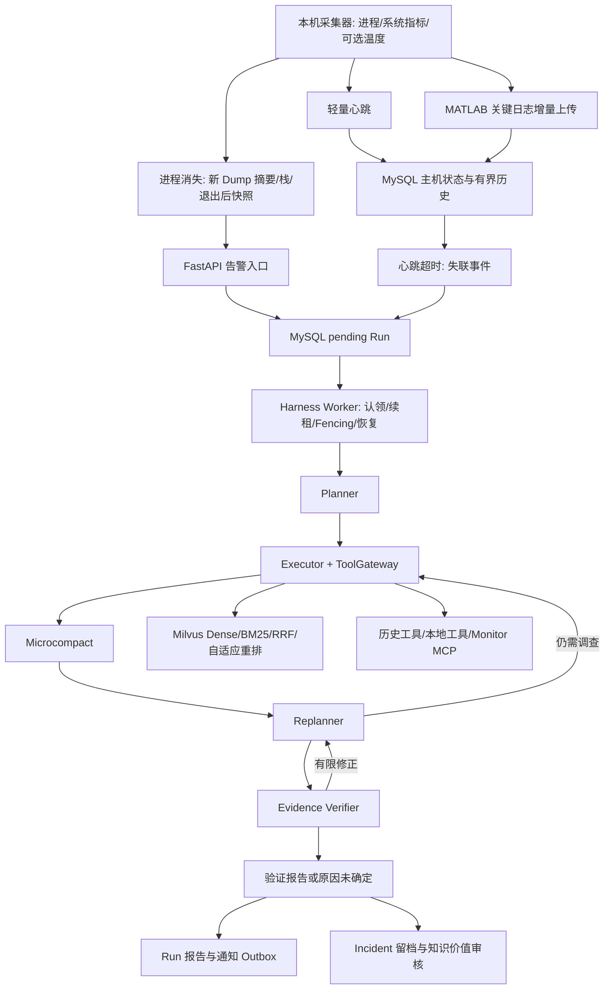

# SuperBizAgent 当前架构

更新：2026-10-20；源码核查基线：28b4ce2。本文替换早期 v1.2.1 中已经过时的模型、Mock CLS、字符切分、空测试目录和 Redis 改造计划描述。

## 项目定位

面向 MATLAB 桌面进程的监控、证据收集和辅助诊断原型。进程消失、MATLAB 报错、进程崩溃和主机心跳失联分别处理，不能互相等同。没有实现自动修改 MATLAB/Simulink 或未经授权远程修复。

## 主链路

失联时实时 MCP/search_log 禁用，使用冻结历史和 RAG。普通进程告警也冻结已留存的本机历史，避免只能看到退出后的瞬时指标。

## 模块职责

| 模块 | 主要文件 | 行为 |
|---|---|---|
| API | app/api/alerts.py、runs.py、memory.py、file.py | 告警/心跳/日志接收、Run/SSE、人工质量反馈、记忆审核、知识索引 |
| 编排 | app/services/aiops_service.py | 按持久化 phase 路由，候选不提前作为最终报告发布 |
| 诊断 | app/agent/aiops/ | Planner、Executor、Microcompact、Replanner、Evidence、Verifier、Final Report |
| 可靠执行 | app/harness/ | MySQL Run/Step/ToolCall/Event、租约、版本 Fencing、幂等缓存、预算、恢复、通知 |
| 检索 | app/services/vector_*、retrieval_* | Dense/Sparse、RRF、置信度、有限改写、CrossEncoder、Parent 展开 |
| 文档处理 | document_preprocessing.py、document_splitter_service.py、document_identity.py | 同款预处理、H1/H2 Parent、420/64 token Child、来源与内容版本 ID |
| 离线评测 | app/evaluation/、tests/eval_* | 候选池、人工 qrels、冻结版本、未知标签处理、旧集合回归及独立 Judge |
| 本机采集 | scripts/lhm_alert_agent.py、app/harness/log_collector.py | psutil、可选 LHM、进程退出、Dump 摘要、日志游标与重试队列 |
| MCP | mcp_servers/monitor_server.py | 本服务主机的当前 CPU/内存/LHM；不提供伪历史时序 |

## 模型与检索

默认诊断/在线 Verifier 为 deepseek-v4-flash，离线 Judge 为 deepseek-v4-pro，均由现有 llm_factory 创建。Verifier 采用独立 Prompt，仍然复用同一模型，不能消除相关性偏差。

Embedding 为 BAAI/bge-small-zh-v1.5（512维归一化向量），CrossEncoder 为 BAAI/bge-reranker-base。Milvus 2.5 使用 Dense FLAT/IP、内置中文 BM25 稀疏索引，分别召回后应用层 RRF 保留两路名次。Child 双路 Top10 命中与唯一 Parent 覆盖用于路由；它不是诊断正确概率。

最终输出按 Parent 章节去重，同一文件可出现多个 Parent。旧文件级评测必须另行去重，不能把 Parent 数量当成相关文件数。重排失败保留 RRF 候选，但显式记录 error、reranker_succeeded=false，并降低检索置信度。

新内容 ID 在文档重新索引时生效，不自动改写既有 biz collection；live_pool 可对旧集合只读映射版本化 ID。线下候选池与线上检索主链路分开。

## 证据与报告

Evidence 记录原文、哈希、来源/位置、Run/host/时间及知识文档版本；模型推断和 query 不是事实。候选结论引用 Evidence ID、逐字原文和快照局部行号。验证先做 Python 确定性检查，再独立调用诊断模型做语义校验。

只有 Final Report 节点写最终 response。SUPPORTED 且 root_cause 非空才表示本次候选根因通过验证；弃权也可安全结束。失败在剩余 Step/Tool/验证预算内回 Replanner，最多两次修正；预算耗尽或相同结论同证据重复时输出事实、原因未确定和待补证据。

## 持久化与恢复

MySQL 是业务执行状态真源；LangGraph MemorySaver 只保存进程内图状态。每个节点更新合并到 state_json，phase 指向下一节点。恢复不清空 past_steps、证据、工具记录、LoopGuard、验证次数或截止时间。

version 是每次认领递增的 Fencing Token，续租及普通写入不递增。关键写入校验 run/worker/version/租约，旧 Worker 不能覆盖接管后的结果。总 deadline 在第一认领时形成并保留。Step 成功但图快照未保存的间隙，可复用 Step/ToolCall 的结果和 evidence。

默认 8 Step、20 次逻辑工具调用、两次无进展、300秒总期限、工具有限重试、最多3次验证。有效图递归上限至少34。SMTP 通过事务通知 Outbox 发送，异常可能是 uncertain，不能承诺 exactly-once。

## 数据边界

MySQL 保存默认两小时、有容量上限的指标和 MATLAB 关键日志，不是全量日志平台。Dump 原文件仍在本机，服务端主要保存摘要、栈和可追溯元数据。search_log 是 FastAPI 本地日志；Monitor MCP 的 service_name 不选择目标主机。心跳失联只能证明服务端未收到心跳。

## 测试与评测

本轮完整回归 158 passed、2 skipped；随后在一次独立临时 MySQL 库中运行这两项得到2 passed，并清理临时库和用户。真实 Milvus 检索、40+10 自适应评测、固定链路对照，以及2个合成场景的真实模型/Judge 冒烟均已执行。没有运行 MATLAB 注入或真实事故准确率验收。

当前部署集合228个Chunk；人工候选池50条查询、1266候选全部未标注。不得用旧 relevant_docs 或模型分数伪装成人工真值。具体指标、命令、样本边界与限制见 [本轮验收报告](docs/aiops-improvement-20261020.md)。

## 进一步说明

- [验证器与恢复协议](docs/evidence-verification.md)
- [检索评测及标注方法](docs/retrieval-evaluation.md)
- [MCP 与数据链路核查](docs/mcp-evidence-audit.md)
- [持久化 OnCall 与迁移](docs/durable-oncall.md)
- [安全故障样本](tests/fault_injection/README.md)
