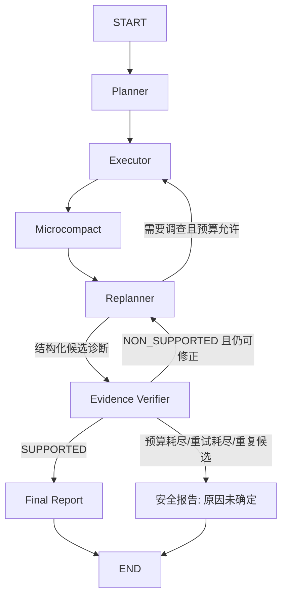

# Evidence Verifier 与诊断状态管理

更新：2026-10-21。实现入口：`app/agent/aiops/verifier.py`、`evidence.py`、`replanner.py` 和 `app/services/aiops_service.py`；已登记Prometheus查询的主机、求值时间、表达式与逐点原始数据。

## 状态流转



Replanner 不再写最终 `response`，也不向 SSE 提前发送 `final_report`。Final Report 根据已验证结构化结论确定性渲染；旧 `Response.response` 兼容字段不进入报告。没有根因断言的候选可以安全弃权；`SUPPORTED` 不等于已经确认根因，必须同时检查 `root_cause`。

## 数据结构

`app/models/diagnosis.py` 定义四类 Pydantic 结构：

| 结构 | 字段与语义 |
|---|---|
| Evidence | `evidence_id`、`kind`、`source_type`、`source`、`locator`、`text`、`content_hash`、Run/host、事件与接收时间、document/version/parent/chunk ID |
| Citation | `evidence_id`、逐字 `quote`、证据快照局部 `line_start/line_end`，从 1 开始 |
| CandidateDiagnosis | `root_cause`（未知为 null）、逐条 `claims` 及 citations、未执行的建议、缺失证据 |
| VerificationResult | `SUPPORTED/NON_SUPPORTED`、reason、unsupported_claims、missing_evidence、contradicting_evidence_ids |

`kind` 区分 `incident_fact`、`knowledge`、`model_inference`。只有经过代码适配的来源可以登记事实；LLM 摘要、搜索词和任意工具字符串不会自动升级为事实。

局部行号对应保存在注册表的原文快照，不冒充原文件行号。`locator` 保存原文件行号、字节 offset、host_evidence ID、章节或 Chunk。原文和哈希随State持久化，Microcompact只缩短模型上下文，不能删除注册证据。有限提示词与报告优先展示Dump、栈、关键运行日志及最近指标，避免大量旧指标挤掉本次错误日志。日志接收时间与日志事件时间分开；采集器当前 ts 是采集时间，不是解析出的 MATLAB 内嵌日志时间。

## 证据进入链路

1. `execute` 从告警 payload 及冻结主机历史登记观测字段、Dump 摘要、栈、系统快照和关键运行日志。告警名称与检测器类型不当作已确认根因。
2. Planner 最多一次知识预取，先持久化 `prefetch_tool_calls` 预留，再执行查询；知识原始 Document 元数据保留为 artifact。
3. ToolGateway 以 ToolCall 形式调用 `content_and_artifact` 工具，保留 Document；在截断结果之前生成 Evidence，并随成功 ToolCall 保存。Step 成功但图 checkpoint 尚未写入时，恢复可以从 Step 的 evidence 补回注册表。
4. 普通告警也冻结已有主机历史，`read_host_history`读取本次任务快照。主机失联时禁止实时主机工具和`search_log`，仅允许Prometheus查询截止最后心跳的历史，且host_id必须匹配当前任务。
5. FastAPI日志仅标记API日志。Prometheus MCP每个指标点按主机/查询/求值时间登记；单点标记current_metric、历史标记historical_metric，不把求值时间伪称为硬件采样时间。仅当前点不能单独证明根因，历史曲线也仍需语义验证。

## 两阶段验证

确定性阶段检查结构、ID、原文哈希、快照行号、quote 原文子串、来源位置、Run、主机及已知时区时间窗口。根因必须与一条 claim 完全一致，并有本次 Dump/运行日志/历史指标/现场快照支持；仅 SOP、模型推断或当前实时采样不够。引用错位时反馈实际匹配行号，quote 不存在时要求逐字引用或撤回。

通过后，独立 Prompt 复用诊断模型，检查事实支持、过度推断、历史知识冒充事实、矛盾及建议是否被说成已执行。没有分析断言、没有建议的纯弃权候选直接通过确定性安全路径，不额外调用语义模型。

语义模型超时、无效结构和异常均为 `NON_SUPPORTED`。最终发布还会校验候选/引用指纹，并重新进行确定性检查，避免验证后候选或证据被替换。

## 预算与持久化

| State 字段 | 恢复要求 |
|---|---|
| `phase` | 保存下一节点；有剩余旧 plan 也必须优先遵循 phase |
| `evidence_registry/diagnosis_context` | 全量保留，禁止从摘要重新猜测事实 |
| `candidate_diagnosis/candidate_verified/verified_fingerprint` | 候选与验证绑定，生成新候选即未验证 |
| `verification/verification_history` | 保存具体失败原因，不能只保留二分类 |
| `verification_attempts/verification_fingerprints` | 调用前预留，恢复不清零；同候选同证据不反复验证 |
| `past_steps/tool_calls/prefetch_tool_calls/loop_guard` | 累计预算；工具调用以 MySQL ToolCall 为主，临时会话也有 State 计数 |
| `deadline_at` | 第一认领时间起的持久化截止时间；接管及人工 resume 不重开 300 秒窗口 |

默认 8 Step、20 次逻辑工具调用（包括一次 Planner 预取）、最多 2 次修正机会，即最多 3 次验证。工具内部瞬时错误重试仍是同一逻辑调用的有限 attempts，不算新的逻辑调用。Verifier 失败不新建 Run、不重新跑 Planner、不清空证据或步骤。

no_progress/repeated_step 停止采集，但允许受验证次数限制的重新推理。Step/Tool 预算耗尽后若候选不通过，直接安全结束。累计 Run 超时及意外图递归错误会中止执行并保留 checkpoint/错误事件；不会无条件重入图。

有效 `recursion_limit` 至少为 `3*max_steps + 2*(1+max_corrections) + 4`，默认 34，覆盖 Microcompact、验证与最终报告路径。MySQL 的 `state_json` 继续保存节点更新；MemorySaver 仍是进程内缓存，不是 MySQL 原生 LangGraph Checkpointer。没有新增数据库表或 Redis。

## 配置

```dotenv
HARNESS_VERIFICATION_MAX_CORRECTIONS=2
HARNESS_VERIFICATION_TIMEOUT_SEC=30
HARNESS_EVIDENCE_HISTORY_SEC=7200
HARNESS_EVIDENCE_FUTURE_SEC=60
```

只有具备时区的事件时间参与确定性时间错配校验；历史无时区记录不会被伪装成已知 UTC。主机身份仍来自现有采集器/工具，不是独立强认证。

## 验收与限制

`test_evidence_verifier.py`、`test_verifier_graph.py` 覆盖引用不存在/错位/伪造、主机/Run/时间错配、SOP 单独归因、首次通过、推理修正、补充调查、无更多证据、Step/Tool/验证预算、重复候选、验证中断、恢复阶段、截止时间和压缩不丢证据。MySQL 专用测试覆盖真实数据库接管后计数、phase、deadline、证据及 Fencing。

同一模型生成与验证存在相关性偏差。验证不是根因真值，也不保证发现全部矛盾；仍需人工盲评与真实事故样本。历史证据有 TTL/容量限制，Dump 主要保留摘要；无法凭空恢复没有采集的数据。本轮不执行任何自动修复。
